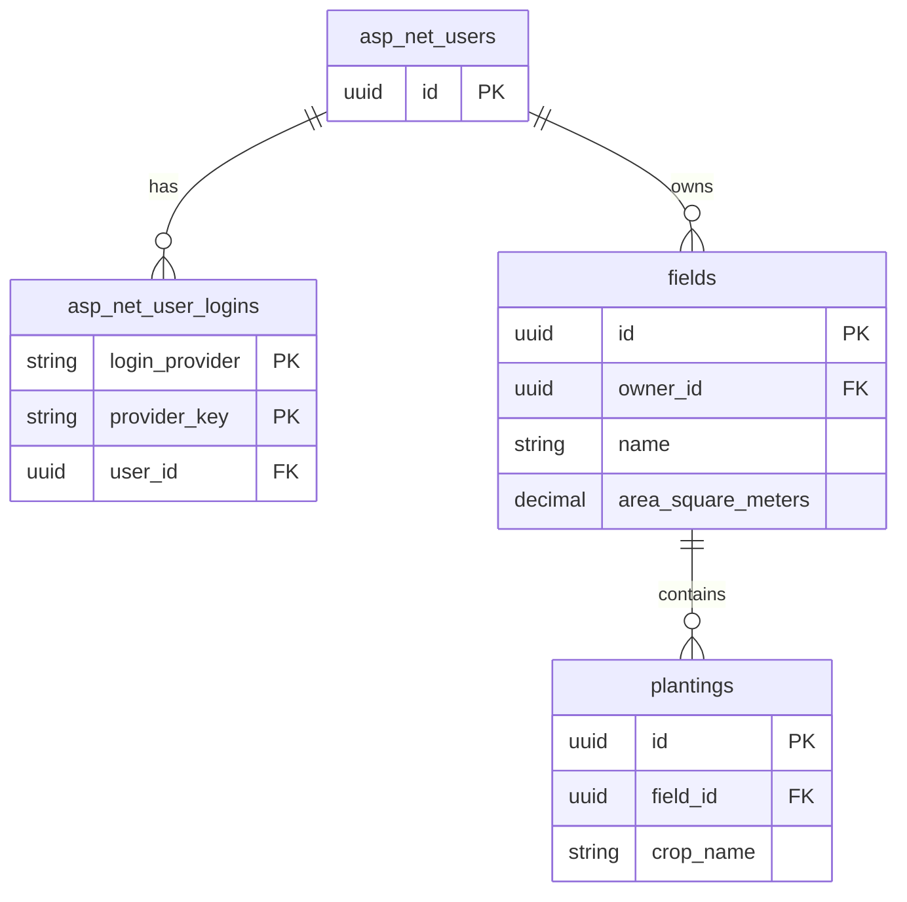

# CropPilot｜首個桌機切片的資料庫與 API 草案

範圍為「首頁 → 登入 → 新增田區 → 新增規劃中的栽培 → 回總覽」。欄位和操作流程依照已審查的 Figma 與驗收條件。這份設計供審查，API 的可生成契約見同一專案中的 OpenAPI YAML。[Figma 審查記錄](../ui/first-desktop-slice/README.md) · [驗收條件](../requirements/desktop-field-and-planting.md#驗收切片) · [OpenAPI 契約](../openapi/openapi.yaml)

## 資料模型

每個農民帳號可有多塊田區，每塊田區可同時有多筆栽培紀錄。帳號擁有田區，栽培紀錄透過田區取得擁有者。首頁由 Angular 提供，登入後的讀寫均以伺服器認證的帳號為準。

| 資料 | 欄位 | 限制 |
| --- | --- | --- |
| 帳號 | `id`、`user_name`、`password_hash` | 提案由 ASP.NET Core Identity 管理。本機準備測試帳號供登入及資料隔離驗收。只用 Google 登入的帳號可沒有密碼雜湊。 |
| 外部登入 | `login_provider`、`provider_key`、`user_id` | 使用 Identity 外部登入資料。Google 的 `sub` 作為 `provider_key`。 |
| 田區 | `id`、`owner_id`、`name`、`area_square_meters`、`latitude`、`longitude`、`notes` | `owner_id` 關聯帳號。名稱去除頭尾空白後必填，面積必填且大於零。緯度與經度可一併留空，填寫時須成對且落在 ±90 與 ±180 度以內。備註選填。 |
| 栽培紀錄 | `id`、`field_id`、`crop_name`、`variety`、`planned_planting_date`、`actual_planting_date`、`status`、`notes` | `field_id` 關聯田區，作物名稱必填。品種、預定栽種日與備註選填。首切片由伺服器將狀態設為 `planned`，實際栽種日留空。 |

- 提案使用 PostgreSQL。田區面積與座標採 `numeric`，由 C# `decimal` 對應。資料庫對名稱、面積和成對座標設約束，API 也驗證這些條件，以便 Angular 顯示對應欄位的提示。
- 栽種日期使用資料庫 `date`，API 傳 `YYYY-MM-DD` 或 `null`。預定與實際栽種日分開保存，供後續管理切片使用。
- 作物與品種先提案用文字欄位，作物清單來源仍待確認。田區與栽培紀錄的外鍵限制刪除，讓後續管理切片可以保留栽培歷史。

### PostgreSQL 資料表

PostgreSQL 的資料表與欄位統一使用小寫 `snake_case`。帳號由 ASP.NET Core Identity 管理，使用者資料表提案命名為 `asp_net_users`，其主鍵為 `id`。Identity 的其餘資料表與欄位也依同一規則映射。提案採 `Guid` 作為帳號 ID，因此帳號、田區及栽培紀錄的主鍵都使用 `uuid`，由伺服器產生。表名、ID 型別、字數與小數位數為本次審查提案。API JSON 欄位採 OpenAPI 契約中的名稱，例如 `crop_name` 對應 `cropName`。

| 資料表 | 欄位 | PostgreSQL 型別 | 約束 |
| --- | --- | --- | --- |
| `asp_net_users` | `id` | `uuid` | PK，由 Identity 管理 |
| `asp_net_user_logins` | `login_provider`、`provider_key` | 字串 | 複合 PK，由 Identity 管理 |
| `asp_net_user_logins` | `user_id` | `uuid` | NOT NULL，FK → `asp_net_users.id`，有索引 |
| `fields` | `id` | `uuid` | PK |
| `fields` | `owner_id` | `uuid` | NOT NULL，FK → `asp_net_users.id`，有索引 |
| `fields` | `name` | `varchar(120)` | NOT NULL，至少一個非空白字元 |
| `fields` | `area_square_meters` | `numeric(14,4)` | NOT NULL，大於 0 且最多四位小數 |
| `fields` | `latitude`、`longitude` | `numeric(9,6)` | 可為 NULL，填寫時須成對且最多六位小數 |
| `fields` | `notes` | `varchar(1000)` | 可為 NULL |
| `plantings` | `id` | `uuid` | PK |
| `plantings` | `field_id` | `uuid` | NOT NULL，FK → `fields.id`，有索引 |
| `plantings` | `crop_name` | `varchar(120)` | NOT NULL，至少一個非空白字元 |
| `plantings` | `variety` | `varchar(120)` | 可為 NULL |
| `plantings` | `planned_planting_date`、`actual_planting_date` | `date` | 可為 NULL，新增規劃中紀錄時實際栽種日為 NULL |
| `plantings` | `status` | `text` | NOT NULL，預設 `planned`，允許 `planned`、`growing`、`harvesting`、`completed` |
| `plantings` | `notes` | `varchar(1000)` | 可為 NULL |

具名 `CHECK` 約束涵蓋非空白名稱、面積大於零且不超過 `9999999999.9999`、成對且在合法範圍內的座標，以及栽培狀態。座標條件明確要求兩欄皆為 NULL 或皆有值，避免 SQL 的 NULL 比較放過只填一欄的資料。栽培進入 `growing`、`harvesting` 或 `completed` 時須有實際栽種日。API 在儲存前檢查數值精度，超過欄位小數位數就回傳驗證錯誤。[PostgreSQL 約束](https://www.postgresql.org/docs/current/ddl-constraints.html)

### ERD 與外鍵審查



圖中使用 PostgreSQL 的資料表與欄位名稱，並列出關聯所需的主鍵、外鍵和部分業務欄位。每筆外部登入與每筆田區必須屬於一個帳號，每筆栽培紀錄必須屬於一塊田。外鍵使用其目標主鍵的型別，各欄位都設為 `NOT NULL` 並建立索引。

| 外鍵 → 參照主鍵 | 刪除上層資料 | 審查案例 |
| --- | --- | --- |
| `asp_net_user_logins.user_id` → `asp_net_users.id` | 提案沿用 Identity 必填關聯的級聯刪除。 | 使用不存在的帳號建立外部登入資料，資料庫應拒絕。刪除可刪的帳號時，該帳號的外部登入資料應一併刪除。 |
| `fields.owner_id` → `asp_net_users.id` | 提案採 `ON DELETE RESTRICT`。帳號有田區時阻擋刪除，保留田區資料。 | 使用不存在的帳號建立田區，資料庫應拒絕。帳號仍有田區時，資料庫也應拒絕刪除該帳號。 |
| `plantings.field_id` → `fields.id` | 採 `ON DELETE RESTRICT`，符合有栽培紀錄的田區禁止刪除的需求。 | 使用不存在的田區建立栽培，資料庫應拒絕。即使田區只有已結束的栽培，也應阻擋刪除。 |

外鍵確保參照的資料存在。登入者是否擁有該田區，仍由 API 依帳號驗證。欄位層級另審查名稱與面積的 `NOT NULL`、面積大於零的 `CHECK`，以及座標同時留空或成對落在合法範圍的 `CHECK`。[PostgreSQL 約束](https://www.postgresql.org/docs/current/ddl-constraints.html)

### 遷移工具與 SQL 審查

首版已確認由 EF Core Migrations 管理 PostgreSQL 的結構版本，搭配 Npgsql provider。它從 EF Core 模型與快照產生遷移。實作階段先用 `dotnet ef migrations script` 匯出 PostgreSQL SQL，審查資料表與欄位是否符合 `snake_case`，並核對 `FOREIGN KEY`、`ON DELETE`、`NOT NULL`、`CHECK` 與索引。審查後套用到測試資料庫，比對實際約束並執行上表的審查案例。[EF Core Migrations](https://learn.microsoft.com/en-us/ef/core/managing-schemas/migrations) · [SQL 腳本審查](https://learn.microsoft.com/en-us/ef/core/managing-schemas/migrations/applying#sql-scripts) · [Npgsql EF Core provider](https://www.npgsql.org/efcore/)

## API 約定

提案採同源部署及登入 Cookie。Angular 在首次寫入前及登入或登出後取得新的防偽權杖，寫入時在 `X-XSRF-TOKEN` 標頭帶上該權杖。資料 API 依登入身分限制讀寫範圍，建立田區時由伺服器填入擁有者。其他帳號的田區或栽培紀錄視為找不到。

| 操作 | 請求 | 成功結果 |
| --- | --- | --- |
| 取得防偽權杖 | `GET /api/auth/csrf`，可在登入前呼叫 | `204`，設定供 Angular 讀取的 `XSRF-TOKEN` Cookie。 |
| 登入 | `POST /api/auth/login`，傳 `username`、`password` | `204`，設定登入 Cookie。 |
| 開始 Google 登入 | `GET /api/auth/google`，由瀏覽器整頁導覽 | `302`，透過 `Location` 跳轉到 Google。 |
| 登出 | `POST /api/auth/logout` | `204`，清除登入 Cookie。 |
| 田區管理與田區選單 | `GET /api/fields` | `200`，回傳自己的田區陣列。 |
| 新增田區 | `POST /api/fields`，傳名稱、面積及選填欄位 | `201`，回傳已建立的田區，並以 `Location` 指向 `GET /api/fields/{fieldId}`。 |
| 查詢田區 | `GET /api/fields/{fieldId}` | `200`，回傳田區。 |
| 新增規劃中的栽培 | `POST /api/fields/{fieldId}/plantings`，傳 `cropName` 及選填的 `variety`、`plannedPlantingDate`、`notes` | `201`，回傳已建立的栽培紀錄，並以 `Location` 指向該紀錄的查詢端點。 |
| 查詢栽培紀錄 | `GET /api/fields/{fieldId}/plantings/{plantingId}` | `200`，回傳指定田區的栽培紀錄。 |
| 田區總覽 | `GET /api/overview` | `200`，回傳自己的田區陣列，每筆加上 `plantings`。田區沒有目前的栽培紀錄時，`plantings` 為空陣列。 |

田區回應含 `id`、`name`、`areaSquareMeters`、`latitude`、`longitude`、`notes`。栽培紀錄回應含 `id`、`fieldId`、`cropName`、`variety`、`plannedPlantingDate`、`actualPlantingDate`、`status`、`notes`。選填欄位缺省或為 `null` 時存為 `null`，回應也使用 `null`。總覽可顯示 `planned`、`growing`、`harvesting`，首切片只會新增 `planned`。後續切片處理編輯、刪除與狀態變更。

只填必填欄位即可建立田區。以下請求送往 `POST /api/fields`，兩個座標欄位會存為 `null`。

```json
{
  "name": "北側田",
  "areaSquareMeters": 1200
}
```

| 情況 | HTTP 回應 | Angular 畫面 |
| --- | --- | --- |
| 必填欄位缺漏，或欄位、路徑參數格式錯誤 | `400`，回傳 `errors`，以 JSON 欄位或參數名對應訊息陣列。 | 在相應欄位旁顯示提示，保留輸入。 |
| 防偽權杖缺漏或驗證失敗 | `400`，回傳問題說明與空的 `errors`。 | 顯示請求失敗，保留輸入。 |
| 登入資料錯誤 | `401`，通用登入失敗訊息。 | 顯示帳號或密碼錯誤，可重試。 |
| 未登入或工作階段已失效 | `401`。 | 導回登入。 |
| 田區或栽培紀錄不存在，或屬於其他帳號 | `404`。 | 提示找不到資料，提供返回列表的入口。 |
| 伺服器儲存失敗 | `500`，通用錯誤訊息。 | 留在表單並保留輸入，讓使用者重試。 |

### Google 登入

Google 提供 OpenID Connect（OIDC）身分驗證，建立在 OAuth 2.0 上。OAuth 2.1 仍是 IETF 草案。CropPilot 使用 ASP.NET Core 的官方 `AddOpenIdConnect` 接 Google，以授權碼流程搭配 PKCE。CropPilot 是 OIDC 用戶端，Google 提供授權端點與換發權杖的端點。[Google OpenID Connect](https://developers.google.com/identity/openid-connect/openid-connect) · [ASP.NET Core OIDC 設定](https://learn.microsoft.com/en-us/aspnet/core/security/authentication/configure-oidc-web-authentication?view=aspnetcore-10.0) · [OAuth 2.1 草案](https://datatracker.ietf.org/doc/draft-ietf-oauth-v2-1/)

1. Angular 的「以 Google 帳號登入」以連結整頁導覽到 `GET /api/auth/google`。CropPilot 的入口呼叫 `Challenge`，中介軟體回傳 Google 授權網址。帳密登入由 `POST /api/auth/login` 呼叫 Identity 的帳密驗證。
2. Google 導回註冊的 `/signin-google`，此路徑由 OIDC 中介軟體接收。中介軟體驗證 `state`、換取並驗證 ID token（含 `nonce`），再交由 CropPilot 完成帳號查找與工作階段建立。設定採 `response_type=code`、`response_mode=query` 及 `openid email` 範圍。`/signin-google` 的回呼路徑需轉送到 ASP.NET Core，並以各環境完整 HTTPS 網址註冊於 Google。用戶端密鑰放在伺服器端設定。[Google 回呼與 ID token 驗證](https://developers.google.com/identity/openid-connect/openid-connect)
3. 身分對應成功後，後端設定 `CropPilot.Session` Cookie，將瀏覽器導向 `/dashboard`。Angular 照常用 Cookie 呼叫 API，首次寫入前取得新的防偽權杖。Google 權杖留在伺服器端處理。取消時導回 `/login?error=google_cancelled`，其他失敗導回 `/login?error=google_sign_in_failed`，由 Angular 顯示提示並讓使用者重試。

依 `Google` 與 ID token 的 `sub` 找出已連結帳號。首次登入須有已驗證的電子郵件，且該郵件未對應既有帳號，才會自動建立無密碼的 CropPilot 帳號，並在同一筆交易寫入外部登入關聯。帳號的 `normalized_email` 有唯一索引。若電子郵件已對應既有帳號，提示使用原帳密登入，待後續提供帳號連結流程。[Google 的身分識別欄位](https://developers.google.com/identity/openid-connect/reference#id-tokens)

`MapIdentityApi` 可提供內建的帳密 `/login` 及其他帳號管理路由。CropPilot 的 `POST /api/auth/login` 採本專案契約的欄位與回應，由 Identity 驗證帳密。Google 的瀏覽器入口寫入 OpenAPI，供雙方對照，Angular 用整頁導覽啟動。Google 回呼由中介軟體接收，因此實作文件另列 `/signin-google`。[ASP.NET Core Identity 內建 API](https://learn.microsoft.com/en-us/aspnet/core/security/authentication/identity-api-authorization?view=aspnetcore-10.0)

## OpenAPI 契約與程式碼生成

已確認採 contract-first。Stoplight 匯出的原檔沿用 OpenAPI 3.1.0，已填入首個切片的操作、請求及回應模型、Cookie 認證、防偽權杖與錯誤格式。每個操作有獨立的 `operationId`。JSON API 的錯誤回應使用 `application/problem+json`，Google 登入入口則使用瀏覽器跳轉。[openapi.yaml](../openapi/openapi.yaml)

使用 OpenAPI Generator 7.27.0 驗證規格並試產兩端程式碼。C# 使用 `aspnetcore` 生成抽象 Controller 與 DTO，Angular 使用 `typescript-angular` 生成服務與型別。已檢查新增田區的名稱、面積及可為 `null` 的座標型別。實作時再以 `POST /api/fields` 驗證兩端編譯、HTTP 回應及重複生成。OpenAPI Generator 將 3.1 列為 beta。[C# generator](https://openapi-generator.tech/docs/generators/aspnetcore/) · [Angular generator](https://openapi-generator.tech/docs/generators/typescript-angular/) · [OpenAPI 版本相容性](https://github.com/OpenAPITools/openapi-generator#1---installation)

串接時將 Angular client 的 base path 設為空字串，讓請求走同源的 `/api/...`，並由 Angular 傳送防偽標頭。C# 端接上登入與防偽驗證，將錯誤轉為契約中的狀態碼與格式。新增田區另外驗證面積嚴格大於零、小數位數及座標是否成對。

## 第一輪驗收重點

1. 只傳名稱和正數面積可新增田區，重新查詢仍取得相同資料，座標為 `null`。缺名稱、缺面積或面積小於等於零時，應拒絕請求且沒有新增資料。
2. 緯度與經度都留空可儲存，填齊合法值也可儲存。只填其一或超出範圍時，應回傳欄位錯誤。
3. 使用自己新增的田區建立一筆栽培紀錄，預定栽種日留空。回到總覽可查到該紀錄，狀態顯示「規劃中」，日期顯示「尚未設定」。
4. 使用另一個測試帳號，確認無法查詢他人的田區，也無法在他人田區新增栽培紀錄。登出後查詢總覽應回傳 `401`。
5. Google 登入成功後導回總覽，同一個 Google 帳號再次登入會取得原本的田區。取消登入或回呼驗證失敗時回到登入頁，顯示提示且可重試。驗證同一個 Google 帳號只會建立一個 CropPilot 帳號，且電子郵件衝突時會提示使用原帳密登入。
