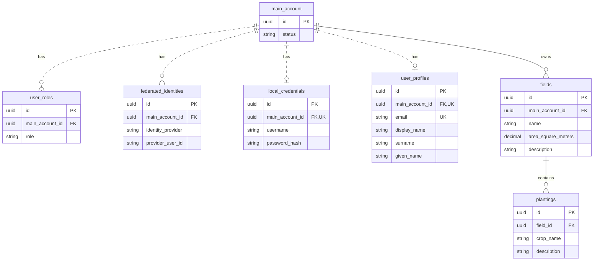

# CropPilot｜首個桌機切片的資料庫設計

這份草案涵蓋主帳號、角色、登入資料、田區、栽培紀錄及個人資料。登入流程與 API 請求、回應見同一目錄的 API 設計。[API 設計](first-desktop-slice-data-api.md)

## 資料模型

每個農民帳號可有多塊田區，每塊田區可同時有多筆栽培紀錄。主帳號擁有田區，栽培紀錄透過田區取得擁有者。本地帳密和外部身分都對應到主帳號。首頁由 Angular 提供，登入後的讀寫均以伺服器認證的主帳號為準。

| 資料 | 資料表與欄位規格 | 用途 |
| --- | --- | --- |
| 主帳號 | [main_account](#main_account) | 田區和登入方式都關聯到此帳號。 |
| 帳號角色 | [user_roles](#user_roles) | 記錄主帳號獲得的 `USER` 與 `ADMIN` 角色。 |
| 外部身分 | [federated_identities](#federated_identities) | 每個主帳號可綁定多個外部身分。 |
| 本地帳密 | [local_credentials](#local_credentials) | 每個主帳號最多一筆。只用 Google 登入的帳號可以沒有這筆資料。 |
| 個人資料 | [user_profiles](#user_profiles) | 每個主帳號最多一筆，保存 Email、顯示名稱、姓氏和名字。 |
| 田區 | [fields](#fields) | 記錄田區名稱、面積和選填的座標與備註。 |
| 栽培紀錄 | [plantings](#plantings) | 記錄各田區的作物和栽培狀態。 |

- 提案使用 PostgreSQL。田區面積與座標採 `numeric`，由 C# `decimal` 對應。資料庫對名稱、面積和成對座標設約束，API 也驗證這些條件，以便 Angular 顯示對應欄位的提示。
- 栽種日期使用資料庫 `date`，API 傳 `YYYY-MM-DD` 或 `null`。預定與實際栽種日分開保存，供後續管理切片使用。
- 作物與品種先提案用文字欄位，作物清單來源仍待確認。田區與栽培紀錄的外鍵限制刪除，讓後續管理切片可以保留栽培歷史。

### PostgreSQL 資料表

PostgreSQL 的資料表與欄位統一使用小寫 `snake_case`。應用程式的資料表一律以單欄 `id` 為主鍵，型別為 `uuid`。新 ID 由伺服器產生。指向這些主鍵的外鍵也使用 `uuid`。以下登入表結構是設計稿，待資料庫設計審查後再接續實作。API JSON 欄位採 OpenAPI 契約中的名稱，例如 `crop_name` 對應 `cropName`。

#### main_account

| 欄位 | PostgreSQL 型別 | 約束 | 描述 |
| --- | --- | --- | --- |
| `id` | `uuid` | PK | 由 Identity 管理的主帳號識別碼。 |
| `status` | `varchar(32)` | NOT NULL，預設 `PENDING`，以 `CHECK` 限定 `PENDING`、`ACTIVE` 或 `DISABLED` | 決定主帳號能否登入。 |

| 狀態 | 規則 |
| --- | --- |
| `PENDING` | 新建本地帳密帳號的初始狀態。通過一次性驗證碼（OTP）後轉為 `ACTIVE`。 |
| `ACTIVE` | 可登入。以已驗證的 IdP 身分首次自動建帳時，直接以此狀態建立。 |
| `DISABLED` | 已停用。帳密與 IdP 均無法建立登入工作階段，帳號和田區資料仍保留。 |

已綁定的 IdP 登入會沿用既有帳號狀態。帳密錯誤造成的暫時鎖定由 Identity 的鎖定機制處理。

#### user_roles

| 欄位 | PostgreSQL 型別 | 約束 | 描述 |
| --- | --- | --- | --- |
| `id` | `uuid` | PK | 由伺服器產生的角色指派 ID。 |
| `main_account_id` | `uuid` | NOT NULL，FK → `main_account.id` | 取得此角色的主帳號。 |
| `role` | `varchar(16)` | NOT NULL，以 `CHECK` 限定 `USER` 或 `ADMIN` | `USER` 是一般農民使用者，`ADMIN` 是後臺管理者。 |

`(main_account_id, role)` 的組合必須唯一。同一帳號可各有一筆 `USER` 和 `ADMIN`。後端在一般使用者建帳的同一筆交易指派 `USER`，`ADMIN` 的指派流程待後臺需求審查時定義。[授權設計](first-desktop-slice-data-api.md#角色授權)

#### federated_identities

| 欄位 | PostgreSQL 型別 | 約束 | 描述 |
| --- | --- | --- | --- |
| `id` | `uuid` | PK | 由伺服器產生的外部身分紀錄 ID。 |
| `main_account_id` | `uuid` | NOT NULL，FK → `main_account.id`，有索引 | 此外部身分綁定的 CropPilot 主帳號。 |
| `identity_provider` | `varchar(32)` | NOT NULL，首版以 `CHECK` 限定為 `GOOGLE` | CropPilot 定義的身分提供者代號，由後端根據已驗證的登入來源設定。 |
| `provider_user_id` | `varchar(255)` | NOT NULL | 使用者在該身分提供者的識別碼。Google 登入取自已驗證 ID token 的 `sub`。 |

`(identity_provider, provider_user_id)` 的組合必須唯一。Google 的 `sub` 最多 255 個 ASCII 字元。若日後接入支援多租戶的 Entra ID，查找鍵須納入發行者或租戶。[Google 身分識別欄位](https://developers.google.com/identity/openid-connect/reference#id-tokens) · [Microsoft Entra 權杖驗證](https://learn.microsoft.com/en-us/entra/identity-platform/access-tokens#validate-the-issuer)

#### local_credentials

| 欄位 | PostgreSQL 型別 | 約束 | 描述 |
| --- | --- | --- | --- |
| `id` | `uuid` | PK | 由伺服器產生的本地帳密紀錄 ID。 |
| `main_account_id` | `uuid` | NOT NULL，FK → `main_account.id`，唯一 | 使用此組帳密的主帳號。 |
| `username` | `varchar(256)` | NOT NULL，`lower(username)` 有唯一索引 | 本地登入帳號。儲存前由後端去除頭尾空白，驗證剩餘內容非空，並保留大小寫。 |
| `password_hash` | `varchar(512)` | NOT NULL | 由 Identity 產生並驗證的密碼雜湊。欄位長度適用於雜湊字串。 |

建立帳號時，後端以和資料庫索引相同的小寫轉換查重，資料庫的唯一索引也會阻擋同時送出的重複建帳。登入時以去除頭尾空白後的 `username` 區分大小寫查找。[本地登入流程](first-desktop-slice-data-api.md#本地登入)

#### user_profiles

| 欄位 | PostgreSQL 型別 | 約束 | 描述 |
| --- | --- | --- | --- |
| `id` | `uuid` | PK | 由伺服器獨立產生的個人資料 ID。 |
| `main_account_id` | `uuid` | NOT NULL，FK → `main_account.id`，唯一 | 此筆個人資料所屬的主帳號。 |
| `email` | `varchar(256)` | 可為 NULL，有唯一索引 | 個人資料中的 Email。後端在儲存及查重前先去除頭尾空白，再轉成小寫。 |
| `display_name` | `varchar(120)` | 可為 NULL | 使用者希望在介面上顯示的名稱。 |
| `surname` | `varchar(120)` | 可為 NULL | 使用者的姓氏。 |
| `given_name` | `varchar(120)` | 可為 NULL | 使用者的名字。 |

本地建帳暫定以 Email 接收 OTP，因此建帳時須提供 Email。OTP 驗證成功後，將主帳號從 `PENDING` 改為 `ACTIVE`。以 Google 首次自動建帳時，一併建立 `user_profiles` 並保存已驗證的 Email。Email 相同時，依 `user_profiles.main_account_id` 回查該主帳號有哪些登入方式。[Google 登入流程](first-desktop-slice-data-api.md#google-登入)

三個名稱欄位可獨立填寫，首次建帳時可留空。個人資料編輯流程待該功能的需求審查時定義。

#### fields

| 欄位 | PostgreSQL 型別 | 約束 | 描述 |
| --- | --- | --- | --- |
| `id` | `uuid` | PK | 田區識別碼。 |
| `main_account_id` | `uuid` | NOT NULL，FK → `main_account.id`，有索引 | 擁有此田區的主帳號。 |
| `name` | `varchar(120)` | NOT NULL，去除頭尾空白後至少一個非空白字元 | 田區名稱。 |
| `area_square_meters` | `numeric(14,4)` | NOT NULL，大於 0 且最多四位小數 | 田區面積，單位為平方公尺。 |
| `latitude` | `numeric(9,6)` | 可為 NULL，範圍 −90 至 90，與 `longitude` 成對填寫 | 田區定位點的緯度，以十進位度數表示。 |
| `longitude` | `numeric(9,6)` | 可為 NULL，範圍 −180 至 180，與 `latitude` 成對填寫 | 田區定位點的經度，以十進位度數表示。 |
| `description` | `varchar(1000)` | 可為 NULL | 田區備註。 |

#### plantings

| 欄位 | PostgreSQL 型別 | 約束 | 描述 |
| --- | --- | --- | --- |
| `id` | `uuid` | PK | 栽培紀錄識別碼。 |
| `field_id` | `uuid` | NOT NULL，FK → `fields.id`，有索引 | 此筆栽培紀錄所屬的田區。 |
| `crop_name` | `varchar(120)` | NOT NULL，至少一個非空白字元 | 栽培的作物名稱。 |
| `variety` | `varchar(120)` | 可為 NULL | 作物品種。 |
| `planned_planting_date` | `date` | 可為 NULL | 預計開始栽種的日期。 |
| `actual_planting_date` | `date` | `GROWING`、`HARVESTING` 或 `COMPLETED` 時必填，其餘可為 NULL | 實際開始栽種的日期。新增規劃中紀錄時留空。 |
| `status` | `varchar(16)` | NOT NULL，預設 `PLANNED`，以 `CHECK` 限定 `PLANNED`、`GROWING`、`HARVESTING`、`COMPLETED` | 目前的栽培階段。 |
| `description` | `varchar(1000)` | 可為 NULL | 這筆栽培紀錄的備註。 |

田區與栽培的具名 `CHECK` 約束涵蓋非空白名稱、面積大於零且不超過 `9999999999.9999`、成對且在合法範圍內的座標，以及栽培狀態。座標條件明確要求兩欄皆為 NULL 或皆有值，避免 SQL 的 NULL 比較放過只填一欄的資料。栽培進入 `GROWING`、`HARVESTING` 或 `COMPLETED` 時須有實際栽種日。API 在儲存前檢查數值精度，超過欄位小數位數就回傳驗證錯誤。[PostgreSQL 約束](https://www.postgresql.org/docs/current/ddl-constraints.html)

### ERD 與外鍵審查

圖中使用 PostgreSQL 的資料表與欄位名稱，並列出關聯所需的主鍵、外鍵和部分業務欄位。每筆角色指派、外部身分、本地帳密、個人資料與田區都屬於一個主帳號，每筆栽培紀錄屬於一塊田。外鍵使用目標主鍵的型別，並設為 `NOT NULL`。外鍵的查詢由一般索引或唯一索引支援。

| 外鍵 → 參照主鍵 | 刪除上層資料 | 審查案例 |
| --- | --- | --- |
| `user_roles.main_account_id` → `main_account.id` | 採 `ON DELETE CASCADE`，一併刪除該帳號的角色指派。 | 資料庫拒絕不存在的帳號、重複的角色指派，以及 `USER` 和 `ADMIN` 以外的角色值。 |
| `federated_identities.main_account_id` → `main_account.id` | 採 `ON DELETE CASCADE`，一併刪除該帳號的外部身分。 | 資料庫拒絕不存在的帳號與重複的 `(identity_provider, provider_user_id)`。 |
| `local_credentials.main_account_id` → `main_account.id` | 採 `ON DELETE CASCADE`，一併刪除該帳號的本地帳密。 | 資料庫拒絕不存在的帳號、同一帳號的第二筆本地帳密，以及忽略大小寫後重複的 `username`，例如 `Farmer01` 與 `farmer01`。 |
| `user_profiles.main_account_id` → `main_account.id` | 待確認主帳號的刪除規則。 | 資料庫拒絕不存在的帳號、同一帳號的第二筆個人資料，以及重複的小寫 Email。 |
| `fields.main_account_id` → `main_account.id` | 提案採 `ON DELETE RESTRICT`。帳號有田區時阻擋刪除，保留田區資料。 | 使用不存在的帳號建立田區，資料庫應拒絕。帳號仍有田區時，資料庫也應拒絕刪除該帳號。 |
| `plantings.field_id` → `fields.id` | 採 `ON DELETE RESTRICT`，符合有栽培紀錄的田區禁止刪除的需求。 | 使用不存在的田區建立栽培，資料庫應拒絕。即使田區只有已結束的栽培，也應阻擋刪除。 |

外鍵確保參照的資料存在。登入者是否擁有該田區，仍由 API 依帳號驗證。欄位層級另審查名稱與面積的 `NOT NULL`、面積大於零的 `CHECK`，以及座標同時留空或成對落在合法範圍的 `CHECK`。[PostgreSQL 約束](https://www.postgresql.org/docs/current/ddl-constraints.html)

### 遷移工具與 SQL 審查

實作角色授權時，先替既有一般使用者補上 `USER`。現行 Identity 儲存層仍對應 `asp_net_user_claims` 和 `asp_net_user_tokens`，移除這兩張表時須同步調整 Identity 儲存層、登入身分建立流程與 EF 對應。

首版已確認由 EF Core Migrations 管理 PostgreSQL 的結構版本，搭配 Npgsql provider。它從 EF Core 模型與快照產生遷移。實作階段先用 `dotnet ef migrations script` 匯出 PostgreSQL SQL，審查資料表與欄位是否符合 `snake_case`，並核對 `FOREIGN KEY`、`ON DELETE`、`NOT NULL`、`CHECK` 與索引。審查後套用到測試資料庫，比對實際約束並執行上表的審查案例。[EF Core Migrations](https://learn.microsoft.com/en-us/ef/core/managing-schemas/migrations) · [SQL 腳本審查](https://learn.microsoft.com/en-us/ef/core/managing-schemas/migrations/applying#sql-scripts) · [Npgsql EF Core provider](https://www.npgsql.org/efcore/)
