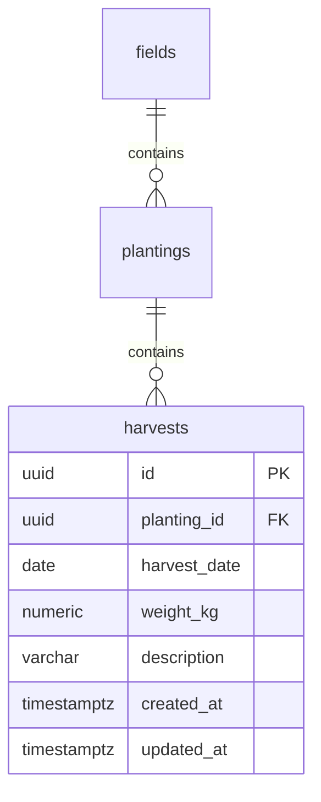
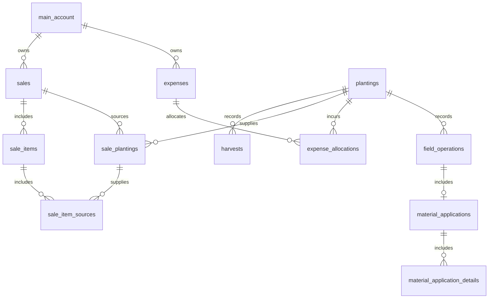

# 栽培詳情與採收｜資料庫與 API 設計提案

## 開發範圍

作物栽培和栽培紀錄共用單批詳情及採收清單。首批交付採收查詢、新增、編輯、刪除、日期篩選和重量排序。靜態稿作為開發依據，Figma 互動接線略過。販售、手動成本與損益查詢依後續切片開發。[採收需求](../requirements/harvest-sales-and-costs.md#採收) · [UX 審查記錄](../prototype-plan.md#ux-草案審查記錄)

## 資料庫

新增 `harvests`。每筆實際採收隸屬一個 `plantings`，同一批次同日可以有多筆。首版依畫面以公斤記重。販售和農會出貨可先關聯 `plantings`，讓使用者事後補登採收。[既有栽培欄位](first-desktop-slice-database.md#plantings)

| 欄位 | PostgreSQL 型別 | 約束 | 用途 |
| --- | --- | --- | --- |
| `id` | `uuid` | PK | 採收紀錄識別碼。 |
| `planting_id` | `uuid` | NOT NULL、FK 至 `plantings.id`、`ON DELETE RESTRICT` | 所屬栽培批次，建立後固定。 |
| `harvest_date` | `date` | NOT NULL | 實際採收日。 |
| `weight_kg` | `numeric(15,6)` | NOT NULL、CHECK 大於 0 | 採收公斤數。API 拒絕超過六位小數或大於 `999999999.999999` 的值，避免儲存時被四捨五入或溢位。 |
| `description` | `varchar(500)` | 可為 NULL | 選填備註，空白正規化為 NULL。 |
| `created_at` | `timestamptz` | NOT NULL、DEFAULT CURRENT_TIMESTAMP | 建立時間。同日排序時使用。 |
| `updated_at` | `timestamptz` | NOT NULL、DEFAULT CURRENT_TIMESTAMP | 成功編輯時更新。 |

以 `(planting_id, harvest_date DESC, created_at DESC, id DESC)` 建立清單索引。重量排序在單批查詢內進行。採收累計由 `SUM(weight_kg)` 即時計算，沒有紀錄時為 `0`。帳號歸屬沿 `harvests.planting_id → plantings.field_id → fields.main_account_id` 查核。既有栽培在 migration 後可直接使用空清單，無須回填採收資料。

## API

詳情抬頭沿用 `GET /api/v1/plantings/{plantingId}` 取得作物、品種、狀態、實際栽種日及占用面積，再以回應中的 `fieldId` 呼叫 `GET /api/v1/fields/{fieldId}` 取得田區名稱。[既有栽培與田區契約](../openapi/openapi.yaml)

| 操作 | 端點 | 成功回應 |
| --- | --- | --- |
| `getHarvets` | `GET /api/v1/plantings/{plantingId}/harvests` | `200`，`HarvestListRsDto`。 |
| `createHarvest` | `POST /api/v1/plantings/{plantingId}/harvests` | `201`，新增的 `HarvestRsDto`。 |
| `editHarvest` | `PUT /api/v1/harvests/{harvestId}` | `200`，更新的 `HarvestRsDto`。 |
| `deleteHarvest` | `DELETE /api/v1/harvests/{harvestId}` | `204`。 |

`SaveHarvestRqDto` 供新增與編輯共用。`harvestDate` 為必填的 `YYYY-MM-DD`，`weightKg` 為必填的 JSON number，`description` 選填。`PUT` 更新完整表單，省略 `description` 或傳 `null` 會清除備註。`HarvestRsDto` 回傳 `id`、`plantingId`、`harvestDate`、`weightKg`、`description`，清單列已包含開啟編輯與刪除確認所需資料。

清單參數 `startDate`、`endDate` 可各自省略，日期邊界均含當日。`sortBy` 可傳 `harvestDate` 或 `weightKg`，`sortDirection` 可傳 `asc` 或 `desc`，預設為 `harvestDate`、`desc`。重量相同時先以日期由新到舊排列。排序欄位相同時以 `created_at DESC`、`id DESC` 固定順序。

`HarvestListRsDto` 回傳 `totalWeightKg` 和 `harvests`。`totalWeightKg` 代表整批累計，日期篩選只套用到 `harvests`。例如整批先後採收 40 與 60 公斤，只篩第二天會回傳一筆 60 公斤，累計仍是 100 公斤。清單與累計應從同一資料快照取得。寫入成功後重新查詢目前的清單，已刪除 60 公斤時由 API 回傳最新累計 40 公斤。

## 驗證與既有行為

- 新增及編輯的採收日最晚為台北當日，已結束批次另不得晚於結束日。已結束批次可補登、修正和刪除採收，批次狀態由既有栽培操作管理。建議開放 `growing`、`harvesting`、`completed` 寫入，`planned` 回 `409`。
- `400` 用於欄位、日期區間及排序值有誤，沿用欄位驗證問題回應。沿用 Bearer 與 `USER` 角色。資源不存在或屬於其他帳號回 `404`。
- 整批刪除預覽 `GET /api/v1/plantings/{plantingId}/delete-preview` 與正式刪除 `DELETE /api/v1/plantings/{plantingId}` 遇到採收紀錄時都回 `409`，問題內容指出該批已有採收。資料庫的限制刪除外鍵保護並行新增與刪除，由 Repository 將對應外鍵衝突轉成同一業務結果。整批刪除沿用既有的批次狀態、預覽版本與退回資材庫存流程。[現行整批刪除端點](../openapi/openapi.yaml) · [整批刪除需求](../requirements/harvest-sales-and-costs.md#栽培批次刪除)
- 驗證重點為同批多筆與同日排序、起訖日期邊界、篩選後整批累計、修改與刪除後重算、歷史補登、跨帳號隔離及整批刪除衝突。

## 販售、成本與損益的資料關聯草圖

先確認各表的責任和關聯，再依後續畫面定義欄位、金額精度與 API。採收、販售來源和成本分攤都以 `plantings.id` 為共同關聯點，先出貨再補採收也能成立。[販售與成本需求](../requirements/harvest-sales-and-costs.md#販售與農會結算)

採收首批只做採收紀錄。販售先以 `sale_plantings` 保存來源批次。進入販售設計時，再依農友是否會記每次採收的出貨重量，以及品質追溯是否納入首版驗收，決定是否新增選填的採收與出貨關聯。

| 資料表 | 用途 |
| --- | --- |
| `sales` | 一筆自行販售或一次農會出貨。記通路、販售或交貨日、結算狀態、確認日、結算扣款與整筆淨額。農會可先存待結算，再確認淨額。 |
| `sale_items` | 販售重量與單價。農會可有多列分級及規格，也可先只登記整筆淨額。 |
| `sale_plantings` | 出貨與已知栽培來源的關聯，同一出貨與批次只保留一筆。批次的收入分攤金額可從空值開始，之後補登。 |
| `sale_item_sources` | 某一分級明細由哪些來源批次供貨，以及各批重量。明細與來源須屬於同一筆出貨。 |
| `expenses` | 一筆手動費用，例如種苗、人工、包材或委託農機。記費用日、類別與整筆金額。 |
| `expense_allocations` | 手動費用分到各批的金額。單一批次負擔時可全額分攤給該批。共用費用可日後再分，同一費用與批次只保留一筆。 |
| `material_application_details`（既有） | 用量乘以所屬批次的 `material_purchase_lots.unit_price`，沿田間作業歸屬栽培。價格空缺時顯示成本待補。 |

- **農場合計**由已確認的販售淨額、手動費用總額與已知資材施用成本查詢計算。農會收入按結算確認日歸期。自售、手動費用及資材施用的日期基準依後續報表設計確認。
- **單批累計**使用各批的收入分攤、手動費用分攤及該批資材施用成本。分攤總額要在同一交易檢查，至多等於來源總額。若結算淨額為 NT$4,700 且北側田分得 NT$2,800，農場仍計 NT$4,700，剩餘 NT$1,900 顯示為未分攤。損益摘要由來源即時計算。
- **帳號與刪除**沿主帳號檢查出貨、費用及所選栽培均屬於同一帳號。已有採收、販售來源或費用分攤時阻擋整批刪除。待結算出貨一旦記下來源，也適用此限制。

## 採收與販售資料範例

以下沿用北側田與南側田的番茄。表內以簡短代號表示識別碼，實際主鍵用 UUID。重量均以公斤計，金額均為新臺幣。

### 採收紀錄 `harvests`

| 採收代號 | 栽培批次 | `harvest_date` | `weight_kg` | `description` |
| --- | --- | --- | ---: | --- |
| H1 | 北側田番茄 | 2026-11-14 | 40 | 第一次採收 |
| H2 | 北側田番茄 | 2026-11-17 | 60 | 第二次採收 |
| H3 | 南側田番茄 | 2026-11-17 | 35 | `null` |

### 販售主檔 `sales`

| 販售代號 | 通路 | 販售或交貨日 | 已確認收入 | 結算確認日 | 扣款 |
| --- | --- | --- | ---: | --- | ---: |
| S1 | 自行販售 | 2026-11-17 | 1,000 | — | 0 |
| S2 | 農會出貨 | 2026-11-17 | 4,700 | 2026-11-20 | 300 |

S2 交貨時先存為「待結算」，確認日和淨額皆可留空。11 月 20 日確認結算時，記下淨額 4,700 元並納入當日農場收入。

### 販售明細 `sale_items`

每筆為一列販售或分級明細。欄位提案如下。

| 欄位 | 型別 | 約束與用途 |
| --- | --- | --- |
| `id` | `uuid` | PK，明細識別碼。 |
| `sale_id` | `uuid` | 必填，FK 至 `sales.id`。 |
| `grade` | `text` | 選填，分級，例如特級。 |
| `size_spec` | `text` | 選填，大小或規格，例如 L。 |
| `weight_kg` | `numeric(15,6)` | 必填、大於 0，整列總重量。 |
| `unit_price_per_kg` | `numeric` | 新臺幣每公斤單價。自行販售必填，農會單價未知時可留空。金額精度待販售設計確認。 |

| `id` | `sale_id` | `grade` | `size_spec` | `weight_kg` | `unit_price_per_kg` |
| --- | --- | --- | --- | ---: | ---: |
| I1 | S1 | `null` | `null` | 10 | 100 |
| I2 | S2 | 特級 | `null` | 50 | 80 |
| I3 | S2 | 優級 | `null` | 25 | 40 |

已知單價時，明細金額由重量乘單價算出。S2 的結算淨額為 `50 × 80 + 25 × 40 − 300 = 4,700`。

### 來源重量 `sale_item_sources`

每筆記錄某個栽培批次供應這列明細的重量。欄位提案如下。

| 欄位 | 型別 | 約束與用途 |
| --- | --- | --- |
| `id` | `uuid` | PK，來源重量識別碼。 |
| `sale_item_id` | `uuid` | 必填，FK 至 `sale_items.id`。 |
| `sale_planting_id` | `uuid` | 必填，FK 至 `sale_plantings.id`，由該筆關聯查到來源栽培批次。 |
| `weight_kg` | `numeric(15,6)` | 必填、大於 0，這個來源批次供應的重量。 |

同一列明細與來源批次只記一筆。`sale_item_id` 與 `sale_planting_id` 須屬於同一筆販售。已知來源重量合計最多等於該列明細重量，部分來源未知時可先記已知的部分。

| `id` | `sale_item_id` | `sale_planting_id` | `weight_kg` |
| --- | --- | --- | ---: |
| W1 | I1 | SP1 | 10 |
| W2 | I2 | SP2 | 30 |
| W3 | I2 | SP3 | 20 |
| W4 | I3 | SP2 | 20 |
| W5 | I3 | SP3 | 5 |

### 販售來源與收入分攤 `sale_plantings`

| `id` | 販售 | 來源批次 | 已分攤收入 |
| --- | --- | --- | ---: |
| SP1 | S1 | 北側田番茄 | 1,000 |
| SP2 | S2 | 北側田番茄 | 2,800 |
| SP3 | S2 | 南側田番茄 | `null` |

兩筆販售確認後，農場收入合計 5,700 元，北側田已分到 3,800 元，農會出貨還有 1,900 元未分攤。日後把 1,900 元分給南側田時，農場收入仍是 5,700 元。北側田的採收累計為 100 公斤，販售來源可查到自售 10 公斤及農會出貨 50 公斤。這兩筆販售都以北側田番茄批次作為來源。
