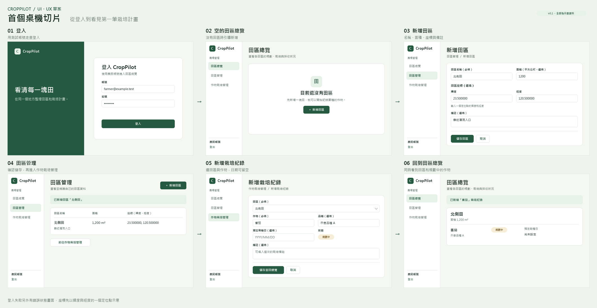

# CropPilot｜首個桌機切片 UI 草案 v0.1

2026-11-11 已在 Figma 播放模式走查作物栽培管理的初次進入、空列表、取消及儲存動線。從田區管理進入後，先選「北側田」再新增栽培。取消會回到原田區的空列表。儲存會回到原田區並顯示新紀錄，再點左側「田區總覽」進入 06。

2026-11-09 確認田區名稱和面積必填，座標選填，Figma 已同步更新。首個桌機切片的 UI／UX 已確認，新增田區、新增栽培及返回總覽的原型動線已走查。登入頁與登入失敗頁的「以 Google 帳號登入」皆已在播放模式驗證可進入田區總覽。實作進度見[功能開發週期](../../development-cycle.md#目前進度)。

- [Figma 設計稿 v0.1](https://www.figma.com/design/BwXm9ifVg4hZyteraSpuvc/CropPilot%EF%BD%9C%E9%A6%96%E5%80%8B%E6%A1%8C%E6%A9%9F%E5%88%87%E7%89%87-v0.1?node-id=0-1)
- [可點選原型，從首頁開始](https://www.figma.com/proto/BwXm9ifVg4hZyteraSpuvc/CropPilot-%E9%A6%96%E5%80%8B%E6%A1%8C%E6%A9%9F%E5%88%87%E7%89%87-v0.1?node-id=8-217&scaling=min-zoom&content-scaling=fixed&starting-point-node-id=8%3A217)
- [可點選原型，登入失敗與重試](https://www.figma.com/proto/BwXm9ifVg4hZyteraSpuvc/CropPilot-%E9%A6%96%E5%80%8B%E6%A1%8C%E6%A9%9F%E5%88%87%E7%89%87-v0.1?node-id=1-188&scaling=min-zoom&content-scaling=fixed&starting-point-node-id=1%3A188&show-proto-sidebar=1)
- [可點選原型，直接開啟 Google 登入入口](https://www.figma.com/proto/BwXm9ifVg4hZyteraSpuvc/CropPilot%EF%BD%9C%E9%A6%96%E5%80%8B%E6%A1%8C%E6%A9%9F%E5%88%87%E7%89%87-v0.1?node-id=1-2&scaling=min-zoom&content-scaling=fixed&starting-point-node-id=8%3A217&show-proto-sidebar=1)
- [可點選原型，直接開啟新增栽培紀錄](https://www.figma.com/proto/BwXm9ifVg4hZyteraSpuvc/CropPilot?node-id=1-117&scaling=min-zoom)

已在 Figma 播放模式確認首頁的兩個登入入口都能進到登入畫面，登入後進入空的田區總覽。也已走查新增田區、新增栽培與返回總覽、兩個取消按鈕，以及登入失敗後的重試。田區管理顯示北側田的面積和座標，總覽顯示規劃中的番茄。Figma 原型用預填示例模擬流程。

上圖保留審查前的流程快照。最新表單見 [SVG 畫面](frames/03-field-new.svg)。

範圍為從首頁進入登入、建立田區、建立一筆規劃中的栽培，再回總覽確認。規則與驗收條件見[桌機版需求草案](../../requirements/desktop-field-and-planting.md)。

## 畫面與 Figma 連線對照

| 畫面 | 主要操作與目的地 |
| --- | --- |
| [00 首頁](frames/00-landing.svg) | 點右上角「登入」或主區塊「登入 CropPilot」，皆進入 01。 |
| [01 登入](frames/01-login.svg) | 點「登入」或「以 Google 帳號登入」，原型皆進入 02。 |
| [01b 登入失敗](frames/01b-login-error.svg) | 顯示帳密錯誤，可修正帳密重試或改用 Google。原型皆模擬成功進入 02。 |
| [02 空的田區總覽](frames/02-overview-empty.svg) | 點「新增田區」，進入 03。 |
| [03 新增田區](frames/03-field-new.svg) | 點「儲存田區」，進入 04；取消回 02。 |
| [04 田區管理](frames/04-field-saved.svg) | 確認田區、面積與座標已顯示。點左側「作物栽培管理」或「前往作物栽培管理」，進入 09。 |
| 05 新增栽培紀錄 | 沿用「北側田」並填作物。預設「規劃中」，預定栽種日可留空。點狀態開啟 14，點「儲存」進入 07，點「取消」回到 08。 |
| [06 回到田區總覽](frames/06-overview-filled.svg) | 看到「北側田」和「規劃中」的番茄。日期留空時顯示「尚未設定」。 |
| 07 作物栽培管理 | 保留「北側田」並顯示新紀錄。點左側「田區總覽」進入 06。 |
| 08 作物栽培管理空列表 | 顯示「北側田」及「這個田區還沒有栽培紀錄」。點「新增栽培紀錄」進入 05。 |
| 09 作物栽培管理初次進入 | 尚未選取田區。點「請選擇田區」進入 10。 |
| 10 田區選項 | 點「北側田」進入 08。 |
| 11 採收中補登 | 實際栽種日選填。儲存進入 12，取消回 08。 |
| 12–13 採收中管理列表與總覽 | 保留「北側田」，顯示「採收中」及「尚未設定」。 |
| 14 栽培狀態選項 | 可選「規劃中」「栽培中」或「採收中」，分別進入 05、15 或 11。 |
| 15–17 栽培中表單、管理列表與總覽 | 實際栽種日必填。原型以預填日期演示儲存後的管理列表與田區總覽。 |

SVG 已匯入 Figma Design 並保留圖層，繁體中文文字已改用 Noto Sans TC。Figma 以 00 作為主要流程的起點，01b 作為登入錯誤的起點。專案中的 SVG 是匯入來源，可供對照。

已在 Figma 播放模式試按 01 和 01b 的 Google 按鈕，兩者都進入 02。原型直接模擬登入成功。實作時會整頁跳到 Google，取消時顯示「已取消 Google 登入」，失敗時顯示「無法以 Google 帳號登入，請再試一次，或使用原帳號密碼登入」。[登入畫面截圖](figma-google-login-verified.jpg)

## 作物栽培管理原型調整

| 畫面或操作 | 已走查的原型行為 |
| --- | --- |
| 從左側導覽進入「作物栽培管理」 | 顯示田區選單。選「北側田」後載入該田區的栽培列表，空列表提供「新增栽培紀錄」。 |
| 新增栽培紀錄 | 沿用已選田區。手動輸入作物名稱，品種和預定栽種日可留空。按「儲存」後回到管理列表。取消也回到該田區的列表。 |
| 儲存後的管理列表 | 「北側田」保持選取，列表顯示新紀錄「番茄」、狀態「規劃中」及日期「尚未設定」。 |
| 切回田區總覽 | 點左側「田區總覽」，在「北側田」下看見同一筆紀錄。 |

串接驗收時，列表載入失敗須保留田區選擇並提供重試。儲存失敗須留在表單，保留輸入並顯示錯誤。重進管理頁並選回同一田區時，列表應從 API 讀回新紀錄。

## 田區表單的審查結果

- 已確認田區名稱及面積（平方公尺）必填，座標及備註選填。
- Figma 以十進位的緯度和經度表示單一定位點。資料庫設計列出座標的精度和成對填寫規則。[資料庫設計](../../design/first-desktop-slice-database.md#postgresql-資料表)
- 畫面中的田區、座標、作物及帳號皆為示意。

2026-11-11 確認田區管理每列提供「編輯」與「刪除」。編輯使用既有田區表單，載入該筆資料，儲存或取消後回田區管理。刪除前顯示田區名稱，按「確認刪除」才送出，成功後更新清單；失敗保留該列並顯示原因。批次刪除僅由 API 提供。
